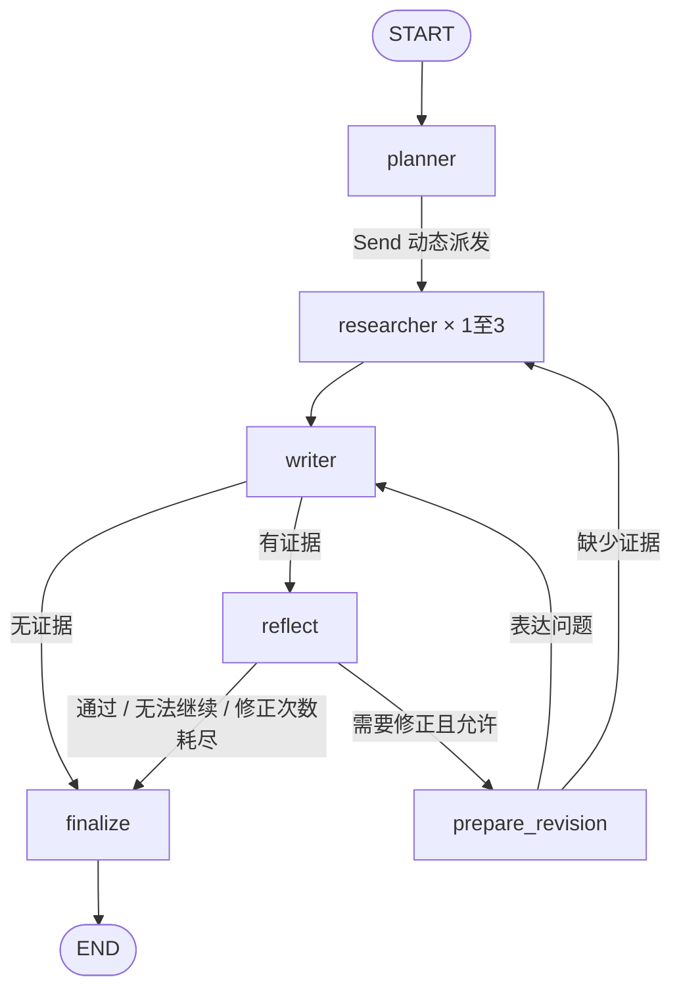

# Planner / Researcher / Writer / Reflect 编排

这是学习版的显式工作流，不是Supervisor动态选择所有角色。Planner决定研究任务，Researcher内部自主调用工具，主图的条件边控制审核修正。

## 先运行

重启8100后端，在 `http://127.0.0.1:8100/docs` 调用 `POST /api/agent`，继续使用已上传论文的file_id：

```json
{
  "file_id": "e72acf3a-53f6-448d-8ece-6b386aed5dda",
  "query": "分别介绍论文的方法、实验表现和局限，请给出原文引用。"
}
```

首次不要传旧版thread_id。响应中tasks展示实际拆分数量，不保证每次一定拆成3个；Planner也可能把相关问题合并。简单问题如“论文使用什么框架”应生成一个任务。后续传返回的新thread_id问“这些实验是否支持它的泛化能力？”，观察主图历史对Planner任务描述的影响。

## 图在哪里

- `backend/app/agent/paper_workflow.py`：主图State/schema、提示词、各节点和连线。
- `backend/app/agent/paper_agent.py`：Researcher复用的 `run_task()` 和 `agent ↔ tools` 子图；原单Agent `run()` 仍保留用于学习和测试。
- `backend/app/routers/agent.py`：现有API改为实例化PaperWorkflow，共享主图saver和会话锁。



Researcher子图现在是 `START → retrieve → generate → END`：程序只执行一次检索（仍返回配置的top-k parent证据），再由一个不绑定工具的模型生成子任务结论。审核只对Writer的最终候选答案执行；Reflect需要新证据时重新派发一个全新的Researcher任务。旧版 `PaperAgent.run()` 的自主 `agent ↔ tools` loop 保留在单任务文档中，主图不再使用它。

## 状态怎么分

| 数据 | 谁保存 | 生命周期 |
| --- | --- | --- |
| 用户问题与最终回答messages | 主图 | 跨轮会话 |
| question、turn_id、tasks | 主图 | 本轮 |
| research_results | 主图，按task_id合并 | 本轮；含研究结论、证据、状态、未解决事项和工具trace |
| answer、sources、review、revision_count | 主图 | 本轮 |
| trace | 主图，追加合并 | 本轮 |
| Researcher messages、tool_calls_used | 各自子图 | 单任务执行；本主图每任务固定一次检索 |

`messages`继承MessagesState的add_messages；任务结果采用字典合并reducer，并行结果不会相互覆盖。每轮初始化使用 `Overwrite({})` / `Overwrite([])` 清空research_results和trace，防止reducer把上一轮结果重新累积进来。

每个Send携带task_id、独立question、必要background与一次检索预算。同一个researcher节点运行多次，不用写researcher1/researcher2。每次执行新建PaperAgent并调用run_task；不会调用恢复会话的run，也不把用户thread_id用作子任务历史。

子图关闭checkpointer；主图checkpoint保存完成后返回的研究结果与trace，不保存子任务内部逐节点checkpoint。任务生命周期结束不代表trace无法查看，但下一任务不会自动使用旧工具消息。

## 上下文怎么组装

| 调用 | 实际发送内容 |
| --- | --- |
| Planner | 专用提示词、输出schema、主图用户/最终助手对话 |
| Researcher | 一次检索得到的原文证据、独立任务及必要背景；生成模型不再看到工具schema，也不会发起第二次检索 |
| Writer | 写作提示词、原问题、各任务结果、去重后的原文证据；修正时还包含审核意见 |
| Reflect | 审核提示词、输出schema、原问题、候选答案、任务结果与原文证据 |

State里有的数据不会自动进入模型。主图不把所有Researcher工具消息追加到用户会话；Writer/Reflect也不读取完整执行trace。补充研究作为新的任务，只接收独立补充查询、原候选结论和审核问题，不恢复旧子任务消息。

Planner和Reflect通过普通chat输出JSON，再用PydanticOutputParser及模型校验。请求不携带强制tool_choice或response_format，避免之前Thinking兼容报错。Writer只返回普通答案；Researcher继续bind_tools。

## Reflect做什么

它从旧版仅检查“问题/答案”扩展为检查“问题/答案/证据”，输出：

```json
{
  "decision": "research",
  "issues": ["缺少独立测试域的实验依据"],
  "retry_queries": ["generalization evaluation unseen domains"],
  "is_sufficient": false
}
```

`is_sufficient`由程序根据decision是否pass生成。pass结束；revise带审核意见回Writer；research在剩余预算内派发新任务，收集补充结果后再写作；insufficient表示无法解决，结束并展示限制。

审核后最多一次修正，无论是修改答案还是补充研究。修正后会再审核一次；再次未通过也必须结束，最终状态为insufficient或工具耗尽时tool_limit。最终用户可见答案会明确附上未解决问题，主图保存的AIMessage与API答案一致。LLM审核仍不能保证事实或引用正确，未实现独立程序化引用核验。

## 预算和返回值

- 整轮默认6次一次性检索预算，最多3个并行Researcher；每个任务消耗1次。初始任务用掉的额度越少，Reflect越可能派发补充任务；正在执行的任务不会互相借额度。
- 最多3个并行Researcher。工具批次超过该任务额度时整批取消；无效参数/未知工具请求也消耗工具计数。
- `tool_calls_used`是所有任务实际交给ToolNode处理的请求总数；`llm_calls_used`是本轮Planner、Researcher、Writer、Reflect请求总数，不等于工具计数。
- 简单问题若一个Researcher检索一次后回答、审核通过，通常是4次LLM请求：Planner1、Researcher1、Writer1、Reflect1；RAG检索本身不是LLM调用。
- 所有研究都无证据时跳过Writer/Reflect的模型调用，确定性返回no_evidence。
- `tasks`返回本轮所有已执行任务（包括补充任务）；`research_results`按task_id返回结论、证据、预算消耗、状态、未解决事项及子任务trace。主图trace包含planner/researcher/writer/reflect/finalize。

InMemorySaver仍在内存中，重启会丢失；同thread并发、更换论文、未完成节点拒绝继续。已加入角色级近似输入预算和逐步证据缩减；中断恢复、PostgreSQL持久化和长期memory仍未加入。

## LangSmith跨轮Trace

LangSmith是观测系统，不替代InMemorySaver。通过环境变量启用后，LangChain/LangGraph会记录主图和Researcher子调用：

```env
LANGCHAIN_TRACING_V2=true
LANGCHAIN_API_KEY=你的LangSmith密钥
LANGCHAIN_PROJECT=scholar-rag-learning
LANGCHAIN_ENDPOINT=https://api.smith.langchain.com
```

主图运行配置携带 `run_name=paper-agent-workflow`、`tags` 和 `metadata.conversation_id/thread_id/turn_id/file_id`。同一个 `thread_id` 的多轮请求在 LangSmith 中可以按 `conversation_id` 筛选；每轮仍有自己的 `turn_id`。Researcher子图继承父运行配置，因此能在同一轮Trace下看到一次检索和生成。

LangSmith记录模型输入输出、工具参数、节点耗时和异常；它不会把历史自动放回模型上下文，也不会替代checkpointer。当前API的 `trace`仍只返回本轮简化记录。论文内容和模型响应会被发送到LangSmith服务，学习时确认隐私要求；不配置API key或保持Tracing=false时，应用继续本地运行。

## 建议阅读顺序

1. `WorkflowState`：哪些字段跨轮，哪些字段本轮重置。
2. `planner()` 和 `dispatch()`：结构化任务如何变成Send。
3. `researcher()` 和 `PaperAgent.run_task()`：如何复用原loop并隔离上下文。
4. `merge_results()`：并行结果如何合并。
5. `writer()` 和 `reflect()`：同一份State怎样选择不同模型输入。
6. `after_review()`、`prepare_revision()`、`finalize()`：修正和结束条件。

验证使用真实LangGraph和脚本化模型，覆盖任务并行、上下文隔离、跨轮重置、共享预算、审核修正、错误和HTTP接口。真实provider的多Agent链路需要重启后手动验收。
